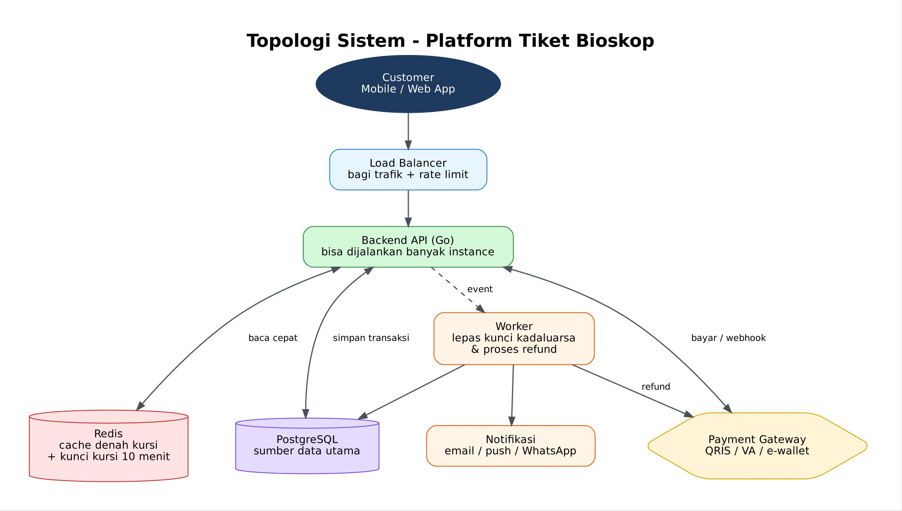
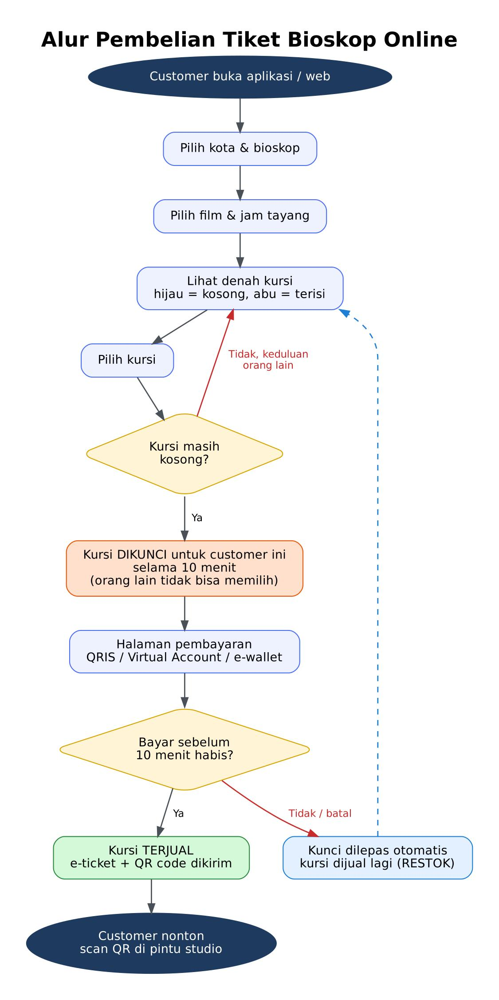
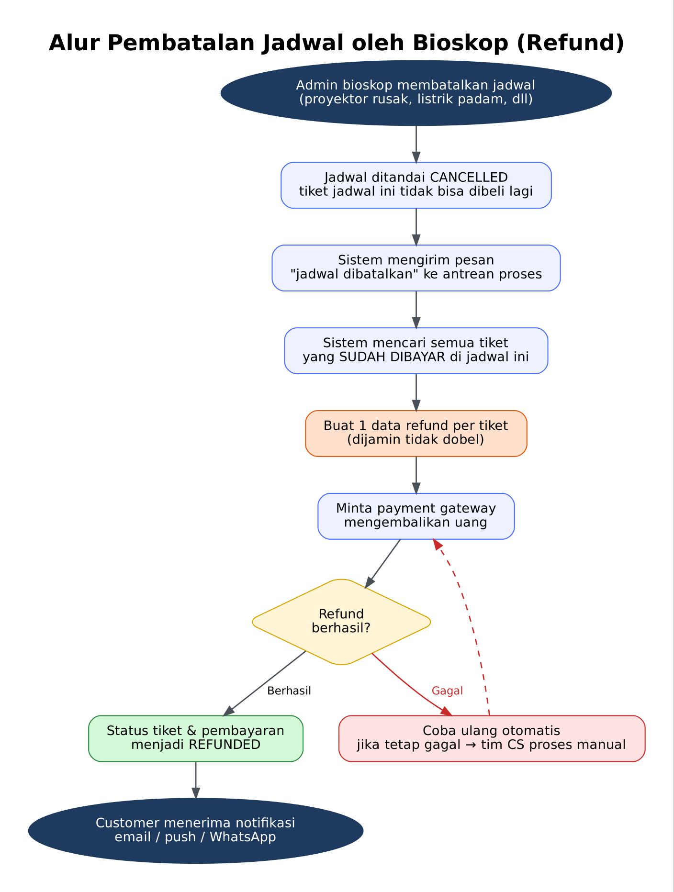

# A. System Design: Platform Tiket Bioskop Online

## 1. Topologi Sistem



| Komponen | Fungsi |
|---|---|
| Load Balancer | Membagi trafik ke beberapa instance Backend API dan membatasi request berlebihan (rate limit) |
| Backend API (Go) | Login, katalog jadwal, pemilihan kursi, booking. Stateless, jadi bisa dijalankan banyak instance saat ramai |
| Redis | Cache denah kursi supaya ribuan orang yang melihat denah tidak membebani database |
| PostgreSQL | Sumber data utama. Semua jaminan "kursi tidak terjual dua kali" ada di sini |
| Payment Gateway | Pembayaran QRIS / VA / e-wallet, mengirim webhook saat pembayaran sukses |
| Worker | Proses di belakang layar: melepas kunci kursi yang kadaluarsa dan memproses refund |
| Notifikasi | Mengirim e-ticket dan info refund via email / push / WhatsApp |

## 2. Flowchart

### Alur beli tiket


### Alur pembatalan jadwal oleh bioskop (refund)


## 3. Sistem Pemilihan Tempat Duduk

**Masalah:** banyak orang bisa membuka jadwal yang sama dan memilih kursi yang sama di detik yang sama. Kursi tidak boleh jatuh ke dua orang, tapi sistem tetap harus cepat.

**Solusi: baca dari cache, kunci di database.**

1. **Stok kursi per jadwal.** Saat admin membuat jadwal, sistem otomatis membuat 1 baris `showtime_seats` per kursi studio dengan status `available`. Stok tiket = jumlah kursi `available`.

2. **Melihat denah (ringan).** Denah kursi disimpan di Redis dan diperbarui setiap ada perubahan status. Request "lihat denah" yang jumlahnya paling banyak tidak menyentuh database.

3. **Mengunci kursi.** Saat customer menekan "Lanjut Bayar", semua kursi yang dipilih dikunci dalam 1 transaksi:
   ```sql
   UPDATE showtime_seats
   SET status = 'locked', locked_by_user_id = $user, locked_until = now() + interval '10 minutes'
   WHERE showtime_id = $showtime AND seat_id = ANY($seats)
     AND (status = 'available' OR (status = 'locked' AND locked_until < now()))
   RETURNING seat_id;
   ```
   - Kalau jumlah kursi yang berhasil dikunci tidak sama dengan yang diminta, transaksi dibatalkan (all-or-nothing) dan customer diminta memilih ulang.
   - PostgreSQL mengunci baris saat `UPDATE`. Jadi kalau dua orang memilih kursi yang sama di detik yang sama, yang satu otomatis menunggu, lalu gagal karena status kursi sudah `locked`. **Hanya satu yang menang.**
   - Booking dibuat dengan status `pending` dan batas bayar 10 menit (`expires_at`).

4. **Pembayaran sukses.** Webhook payment gateway mengubah kursi menjadi `sold`, booking menjadi `paid`, dan payment menjadi `success` dalam 1 transaksi. Kolom `payments.provider_ref` bersifat UNIQUE, jadi webhook yang terkirim dua kali tidak diproses dua kali.

5. **Kenapa tetap cepat untuk banyak orang:** request baca dilayani Redis. Yang sampai ke database hanya `UPDATE` beberapa baris berdasarkan index `(showtime_id, seat_id)`. Data setiap jadwal terpisah, jadi beban tersebar. Backend API stateless, jadi bisa ditambah instance-nya saat ramai.

## 4. Pencatatan dan Restok Tiket

**Pencatatan.** Setiap transaksi tercatat di:
- `bookings`: siapa membeli, jadwal apa, total, status
- `booking_seats`: kursi apa saja dan harga saat dibeli
- `payments`: metode, nominal, status pembayaran
- `refunds`: riwayat pengembalian dana

`booking_seats` tetap tersimpan walaupun kursinya sudah dijual ulang ke orang lain, jadi riwayat dan laporan keuangan tidak hilang.

**Restok otomatis** terjadi saat kursi kembali ke status `available`:
1. **Tidak dibayar dalam 10 menit.** Kunci kursi kadaluarsa. Kursi langsung bisa diambil orang lain karena kondisi `locked_until < now()` di query penguncian, tanpa harus menunggu proses apa pun. Worker berkala merapikan statusnya (booking menjadi `expired`, kursi menjadi `available`) dan memperbarui cache denah.
2. **Customer membatalkan sebelum bayar.** Kursi langsung dilepas.
3. **Refund oleh customer** (jika kebijakan bioskop mengizinkan dan film belum mulai). Setelah refund sukses, kursi dikembalikan ke `available` dan bisa dijual lagi.

**Jadwal tidak bisa bentrok.** Constraint `EXCLUDE USING gist` di tabel `showtimes` menolak dua jadwal aktif yang waktunya overlap di studio yang sama, langsung di level database. Sudah diimplementasikan di API (response 409).

## 5. Refund / Pembatalan dari Pihak Bioskop

1. Admin mengubah status jadwal menjadi `cancelled` lewat `PUT /api/v1/showtimes/{id}` (sudah diimplementasikan). Jadwal tidak bisa dibeli lagi.
   Jadwal yang sudah punya transaksi **tidak bisa dihapus**. API mengembalikan 409 karena dijaga foreign key, jadi data transaksi tidak pernah hilang. Pembatalan selalu lewat status.
2. Sistem mengirim event "jadwal dibatalkan" ke Worker.
3. Worker mengambil semua booking berstatus `paid` di jadwal tersebut, lalu membuat 1 baris `refunds` per booking (`initiated_by = 'cinema'`, nominal 100%). Kolom `refunds.booking_id` bersifat UNIQUE, jadi kalau Worker crash dan diulang, refund tidak akan dobel.
4. Worker meminta payment gateway mengembalikan dana. Kalau gagal, dicoba ulang otomatis. Kalau tetap gagal, status refund menjadi `failed` dan masuk antrean tim CS untuk diproses manual.
5. Kalau sukses: `refunds.status = success`, `payments.status = refunded`, `bookings.status = refunded`, lalu customer menerima notifikasi.

## 6. Pengembangan Jika Trafik Semakin Besar

- **Virtual queue / waiting room** saat penjualan film blockbuster, supaya lonjakan pengunjung masuk bertahap
- **CDN** untuk poster dan aset statis
- **Read replica PostgreSQL** untuk katalog dan laporan
- **Message broker** (RabbitMQ / Kafka) agar event booking dan refund tidak hilang walau Worker sedang mati
- Memecah Backend API menjadi service terpisah (catalog, booking, payment) jika tim dan trafik sudah besar